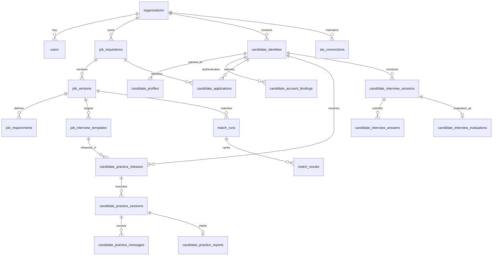
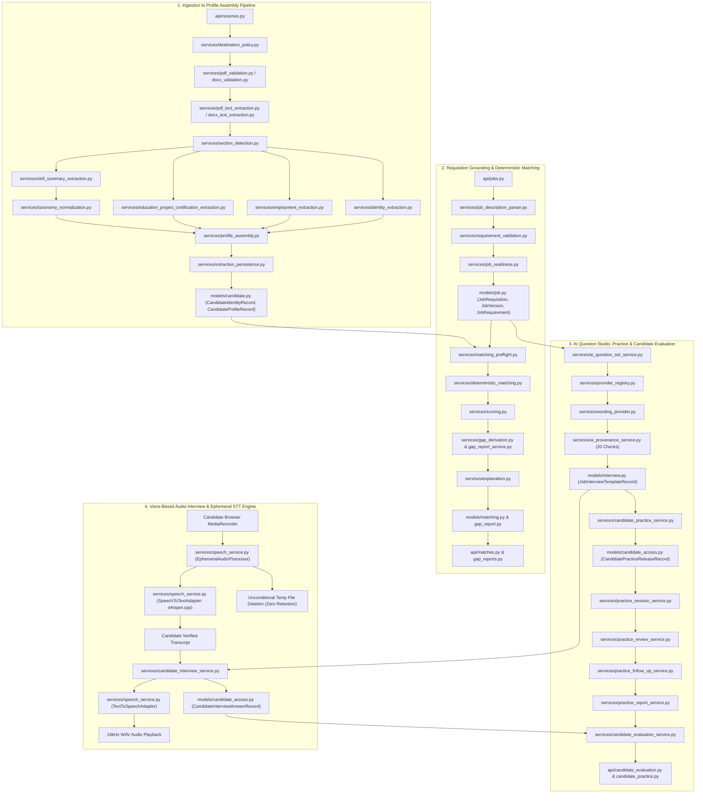

# AI-Hiring Platform: Backend Domain Services, Data Models & API Reference

**Document Version:** 2.2.0 (Comprehensive Reference)  
**Framework:** Python 3.14 | FastAPI 0.115+ | SQLAlchemy 2.0 (PostgreSQL 16) | Pydantic v2 | Alembic  
**Scope:** Complete Backend Directory Inventory, 18 REST Routers, 13 Relational Models, 52 Pydantic Schemas, 78 Domain Services (71 Root + 7 ATS Adapters), 46 Alembic Migrations, and 93 Pytest Test Suites

---

## 1. Backend Architecture & Directory Catalog

The backend follows a layered Clean Architecture pattern where HTTP transport (`api/`), domain business rules (`services/`), data persistence (`models/`), and data transfer serialization (`schemas/`) are strictly decoupled.

```
backend/
├── alembic.ini                              # Configuration file for Alembic migrations
├── pytest.ini                               # Configuration for test execution and markers
├── requirements.txt                         # Production and test Python dependencies
├── app/
│   ├── config.py                            # Environment settings, secrets, AI & Speech runtime configs
│   ├── database.py                          # SQLAlchemy engine, session maker, base model, health checks
│   ├── main.py                              # FastAPI application instantiation, CORS, error handlers, router registration
│   ├── api/                                 # 18 REST API Router Controllers
│   ├── cli/                                 # 3 CLI Utilities & Seeders
│   ├── models/                              # 13 SQLAlchemy Declarative Model Modules
│   ├── schemas/                             # 52 Pydantic Request/Response Schema Modules
│   └── services/                            # 78 Domain Services & Algorithmic Engines (71 Root + 7 ATS)
├── docs/
│   └── evaluation_reviewer_guide.md         # Ground-truth evaluation reviewer guide
├── migrations/
│   ├── env.py                               # Alembic runtime environment loader
│   ├── script.py.mako                       # Template for new migration scripts
│   └── versions/                            # 46 Sequential Database Migration Scripts
├── runtime/                                 # Ephemeral intake, quarantine & audio temp storage
├── tests/                                   # 93 Automated Pytest Test Suites + evaluation_support (6 modules)
└── tools/                                   # Admin bootstrapping and evaluation benchmark tools
```

---

## 2. Core Infrastructure & Configuration Files

### 2.1 `app/config.py`
- **Purpose**: Defines strongly-typed configuration settings loaded from environment variables or `.env` using Pydantic Settings.
- **Key Parameters**:
  - `DATABASE_URL`: PostgreSQL connection string (`postgresql+psycopg2://...`).
  - `SECRET_KEY`: HMAC encryption key for user sessions and cookies.
  - `CSRF_SECRET_KEY`: Dedicated secret for cryptographic CSRF tokens.
  - `SESSION_EXPIRE_HOURS`: Lifespan of active user and candidate sessions (default: 24h).
  - `DEFAULT_AI_PROVIDER_TYPE`, `DEFAULT_AI_PROVIDER_URL`, `DEFAULT_AI_MODEL_IDENTIFIER`: Settings for local LLM inference (MLX/Ollama/OpenAI-compatible).
  - `MAX_UPLOAD_SIZE_BYTES`: Upload size ceiling (default: 10 MB).
  - `QUARANTINE_DIR`, `RESUME_INTAKE_DIR`: Local filesystem paths for staging uploads.

### 2.2 `app/database.py`
- **Purpose**: Initializes SQLAlchemy database engine, scoped session factory (`sessionmaker`), and declarative Base class.
- **Key Components**:
  - `engine`: Created with connection pool tuning (`pool_pre_ping=True`, `pool_size=20`, `max_overflow=10`).
  - `SessionLocal`: Session factory yielding transactional sessions.
  - `get_db()`: FastAPI dependency generator ensuring transactions are cleanly committed or rolled back and closed.
  - `check_database_connection()`: Probing helper checking live PostgreSQL readiness.
  - `Base`: Common DeclarativeBase with UUID primary key helpers and timestamp mixins (`created_at`, `updated_at`).

### 2.3 `app/main.py`
- **Purpose**: Application root creating the FastAPI app instance, configuring middleware, sanitizing validation exceptions, and mounting all API routers.
- **Key Middleware & Handlers**:
  - `CORSMiddleware`: Configured for credentials, origin filtering, and custom headers.
  - `RequestValidationError` Handler: Sanitizes and redacts any sensitive tokens/passwords from error payloads.
  - Standardized `/api/v1/health` endpoint returning database connection status.
- **Router Mounting**: Registers all 18 domain routers under the `/api/v1` namespace.

### 2.4 CLI Utilities (`app/cli/`) & Tools (`tools/`)
- **`app/cli/bootstrap_admin.py` & `tools/bootstrap_admin.py`**: Initializes default organization, administrator credentials, and loads baseline seed data.
- **`app/cli/import_onet.py`**: Imports O*NET occupational taxonomies, concept IDs, and skill relationships from `Local_data/`.
- **`app/cli/matching_evaluation.py` & `tools/run_evaluation.py`**: Runs precision/recall benchmarks on resume parsers and deterministic matching engines against ground truth.

---

## 3. REST API Routers (`app/api/`)

The API layer is partitioned into 18 specialized controllers:

| Router File | Prefix / Tag | RBAC Guard | Description & Key Endpoints |
|---|---|---|---|
| `admin.py` | `/api/v1/admin` | `require_admin` | System health overview, database statistics, security audit event log querying, provider admin controls. |
| `ai_interviews.py` | `/api/v1/ai-interviews` | `require_recruiter` | AI Question Studio generation, slot management, candidate-safe previews, recruiter rubrics, and 20-point validation approval. |
| `ats.py` | `/api/v1/ats` | `require_recruiter` | ATS integration management (Greenhouse, Lever, Local Folder ATS), candidate export, requisition sync. |
| `auth.py` | `/api/v1/auth` | Public / Session | Recruiter/Admin authentication, login (`POST /login`), logout (`POST /logout`), session validation (`GET /me`), password change. |
| `candidate_applications.py` | `/api/v1/candidate/applications` | `require_candidate` | Candidate job application creation, resume upload, status tracking, application submission, and application withdrawal. |
| `candidate_auth.py` | `/api/v1/candidate/auth` | Public / Candidate | Candidate portal authentication, magic token activation (`POST /activate`), candidate login (`POST /login`), candidate session (`GET /me`). |
| `candidate_evaluation.py` | `/api/v1/candidate/evaluation` | `require_candidate` / `require_recruiter` | Candidate interview evaluation, multi-dimensional scoring breakdown, feedback review, and performance analytics. |
| `candidate_invitations.py` | `/api/v1/candidate/invitations` | `require_recruiter` | Recruiter invitation management, generation of magic activation links, candidate account binding queries. |
| `candidate_jobs.py` | `/api/v1/candidate/jobs` | Public / Candidate | Candidate public job discovery board, published requisition listings, requirement summaries. |
| `candidate_practice.py` | `/api/v1/candidate/practice` | `require_candidate` / `require_recruiter` | Recruiter practice release grants, candidate practice interview catalog, practice session lifecycle (`/start`, `/answer`, `/report`). |
| `gap_reports.py` | `/api/v1/gap-reports` & `/api/v1/results` | `require_recruiter` | Generates requirement gap reports comparing candidate skills against job requirements with categorical breakdowns. |
| `interviews.py` | `/api/v1/interviews` & `/api/v1/simulations` | `require_recruiter` | Deterministic interview templates, structured question banks, simulation runs, and human review scores. |
| `job_imports.py` | `/api/v1/jobs/imports` | `require_recruiter` | Ingestion of raw job descriptions from uploaded PDF and Word documents. |
| `jobs.py` | `/api/v1/jobs` | `require_recruiter` | Job requisition CRUD, immutable version creation, grounded requirements, readiness checks, publication toggles. |
| `matches.py` | `/api/v1/matches` | `require_recruiter` | Executes deterministic candidate-job matching, ranking results, component score decompositions, evidence comparison. |
| `recruiter_applications.py` | `/api/v1/recruiter/applications` | `require_recruiter` | Recruiter applicant review workflow, stage transitions (`RECEIVED` -> `IN_REVIEW` -> `INTERVIEW_READY`), interview release. |
| `resumes.py` | `/api/v1/resumes` & `/api/v1/candidates` | `require_recruiter` | Resumé ingestion (`POST /resumes`), parsing, candidate profiles (`GET /{id}`), evidence spans, manual profile corrections. |
| `taxonomy.py` | `/api/v1/taxonomy` | `require_recruiter` | Skill taxonomy search, concept resolution, occupation autocomplete, alias lookup. |

---

## 4. SQLAlchemy Relational Models (`app/models/`)

The database architecture consists of 12 model modules mapping to 35+ tables:



### Detailed Model Inventory
1. **`auth.py`**:
   - `UserRecord`: System user (`id`, `email`, `hashed_password`, `role`: `ADMIN` | `RECRUITER` | `CANDIDATE`, `organization_id`, `status`).
   - `UserSessionRecord`: Active session tracking (`id`, `user_id`, `session_token_hash`, `expires_at`, `ip_address`).
   - `SecurityAuditEventRecord`: Immutable audit logs (`id`, `organization_id`, `user_id`, `event_type`, `resource_type`, `resource_id`, `payload` (JSONB)).
2. **`base.py`**:
   - Declarative `Base` model providing common mixins, UUID primary keys, and timestamp columns.
3. **`job.py`**:
   - `JobRequisition`: Master requisition container (`id`, `organization_id`, `status`, `publication_status`).
   - `JobVersion`: Immutable version record (`id`, `job_id`, `version_number`, `revision`, `title`, `department`, `location`, `employment_type`, `workplace_type`, `summary`, `responsibilities`, `version_status`).
   - `JobRequirement`: Grounded requirement (`id`, `job_version_id`, `category`, `necessity`, `requirement_text`, `taxonomy_concept_id`, `weight`, `display_order`).
   - `JobDescriptionImport`: Raw uploaded document metadata and parsed status.
4. **`candidate.py`**:
   - `CandidateIdentityRecord`: Canonical candidate entity (`id`, `organization_id`, `primary_email`, `full_name`).
   - `CandidateProfileRecord`: Parsed resume snapshot (`id`, `candidate_id`, `version_number`, `raw_text`, `structured_data` (JSONB), `confidence_score`).
   - `ProfileCorrectionRecord`: Audit log of recruiter manual corrections.
5. **`candidate_access.py`**:
   - `CandidateInvitationRecord`: Magic invitation tokens with expiration.
   - `CandidateAccountBindingRecord`: Credential binding for candidate portal access.
   - `CandidateApplicationRecord`: Job applications (`id`, `candidate_id`, `job_id`, `status`, `recruiter_review_state`).
   - `CandidatePracticeReleaseRecord`: Recruiter authorization grant for candidate practice.
   - `CandidatePracticeSessionRecord`: Active candidate practice simulation run.
   - `CandidatePracticeMessageRecord` & `CandidatePracticeAnswerSegmentRecord`: Per-turn conversational transcripts and segmented evaluations.
   - `CandidatePracticeMcqAnswerRecord`: Multiple-choice question selections and answer checks.
   - `CandidatePracticeAnswerReviewRecord`: Real-time per-answer AI feedback records.
   - `CandidatePracticeReportRecord`: Comprehensive multi-dimensional radar coaching scorecard.
   - `CandidateInterviewSessionRecord` & `CandidateInterviewAnswerRecord`: Formal candidate interview sessions and responses.
   - `CandidateInterviewEvaluationRecord` & `CandidateQuestionEvaluationRecord`: Formal interview evaluation scores and criteria marks.
6. **`extraction.py`**:
   - `ResumeExtraction`: Master extraction session container.
   - `ExtractionBlock`: Low-level character spans, bounding boxes, and block types.
7. **`gap_report.py`**:
   - `GapReportRecord`, `GapReportItemRecord`, `GapAuditEventRecord`: Gap analysis results, categorical missing skills, and audit traces.
8. **`interview.py`**:
   - `JobInterviewTemplateRecord`: Validated interview question sets and blueprints.
   - `InterviewQuestionRecord` & `InterviewRubricRecord`: Question stems, rubrics, and 1/3/5 anchor scoring criteria.
   - `CandidateInterviewPlanRecord`: Candidate-specific tailored interview plans.
   - `ProviderProfileRecord`: AI Model provider adapter profiles and health configurations.
   - `SupplementalQuestionProvenanceRecord`: Provenance records for AI-generated follow-up questions.
9. **`matching.py`**:
   - `MatchRunRecord`: Batch matching execution record.
   - `MatchResultRecord`: Deterministic candidate match score, rank, and missing skills.
   - `MatchAuditEventRecord`: Audit log of match executions.
10. **`resume.py`**:
    - `ResumeArtifact`: Raw uploaded resume file records (PDF/DOCX).
    - `ProcessingJob`: Asynchronous extraction intake jobs.
11. **`taxonomy.py`**:
    - `SkillConcept`, `SkillAlias`, `OccupationConcept`, `OccupationAlias`, `OccupationSkillLink`, `TaxonomySnapshot`: Standardized taxonomy graphs.
12. **`ats.py`**:
    - `ATSConnectionRecord`, `ATSExternalJobRecord`, `ATSExternalCandidateRecord`, `ATSExternalAttachmentRecord`, `ATSObjectMappingRecord`, `ATSImportRunRecord`, `ATSImportItemResultRecord`, `ATSSyncCheckpointRecord`, `ATSExportReceiptRecord`, `ATSReconciliationRecord`.

---

## 5. Pydantic Validation Schemas (`app/schemas/`)

The 51 schema modules enforce strict input validation, type transformation, and output filtering:

- **AI Question Studio & Generation**: `ai_question_set.py`, `mcq_contract.py`, `question_generation_contract.py`, `wording_contract.py`, `safety_policy.py`, `interview_blueprint.py`, `interview_snapshot.py`, `interview_api.py`.
- **Candidate Practice & Simulations**: `practice_session_contract.py`, `practice_review_contract.py`, `practice_follow_up_contract.py`, `practice_report_contract.py`, `simulation_assessment.py`.
- **Candidate Access, Applications & Formal Interviews**: `candidate_access.py`, `candidate_application.py`, `candidate_job.py`, `candidate_interview.py`, `candidate_evaluation.py`, `recruiter_application.py`.
- **Candidate Resumes & Extraction**: `resume.py`, `candidate.py`, `extraction.py`, `profile_assembly.py`, `section_and_identity.py`, `employment.py`, `education_project_certification.py`, `skill_and_summary.py`, `correction.py`.
- **Job Requisitions & Matching**: `job.py`, `matching.py`, `match_run.py`, `requirement_match.py`, `requirement_gap.py`, `scoring.py`, `explanation.py`, `taxonomy.py`, `lifecycle.py`.
- **Authentication, Provider Admin & ATS**: `auth.py`, `provider_admin.py`, `provider_capability.py`, `provider_profile.py`, `ats.py`, `ats_dto.py`, `phase3_audit.py`, `phase3_enums.py`, `phase3_protocols.py`, `evaluation.py`, `human_review.py`, `answer_assessment_contract.py`, `assessment_contract.py`, `live_interview_contract.py`.

---

## 6. Domain Services & Algorithmic Engines (`app/services/`)

The service layer contains 76 modules (69 root services + 7 ATS adapters) implementing business logic:

### 6.1 Parsing & Evidence Extraction Pipeline
1. `pdf_text_extraction.py` & `docx_text_extraction.py`: Low-level extractors capturing text lines, font attributes, table cells, and coordinate bounding boxes.
2. `pdf_validation.py` & `docx_validation.py`: File integrity, MIME-type, and malicious payload validation.
3. `destination_policy.py`: Enforces secure destination path routing for uploaded files and quarantine directories.
4. `section_detection.py`: Identifies document columns and section boundaries (`WORK_EXPERIENCE`, `EDUCATION`, `SKILLS`, `PROJECTS`, `CERTIFICATIONS`).
5. `identity_extraction.py`: Regex and heuristic parser extracting candidate name, email, phone number, and location.
6. `date_extraction.py`: Robust date parser converting date formats into standardized date spans.
7. `employment_extraction.py` & `education_project_certification_extraction.py` (with `education_project_certification_rules.py`): Extracts employment history, employer names, job titles, degrees, majors, and certifications.
8. `skill_summary_extraction.py` & `taxonomy_normalization.py`: Normalizes extracted skill terms against the canonical taxonomy graph, resolving aliases.
9. `text_normalization.py`: Unicode normalization, whitespace stripping, and clean text canonicalization.
10. `profile_assembly.py` & `canonical_summary.py`: Master controller assembling raw extraction data into a unified `CandidateProfile`.
11. `extraction_persistence.py`: Stores the profile along with character-level `CandidateEvidenceSpan` records.
12. `profile_correction.py`: Applies recruiter audit patches (`REPLACE`, `DELETE`, `ADD`) to profile fields while preserving original evidence audit logs.

### 6.2 Deterministic Matching & Gap Analysis
1. `deterministic_matching.py`: Core category-weighted scoring engine.
2. `matching_preflight.py`: Preflight validation ensuring jobs and candidates are eligible for matching.
3. `match_orchestration.py`: Orchestrates multi-candidate batch matching runs.
4. `scoring.py`: Mathematical scoring functions for skill, experience, and education requirements.
5. `gap_derivation.py`, `gap_validation.py`, & `gap_report_service.py`: Generates missing skill gap reports categorized by Technical Skills, Experience, and Education with actionable gap summaries.
6. `explanation.py`: Produces transparent, human-readable explanations of match scores and confidence tiers (`HIGH`, `MEDIUM`, `LOW`).

### 6.3 AI Provenance & 20-Point Release Engine (`ai_provenance_service.py`)
Enforces the mandatory 20 server-side validation checks before any AI question set can be approved or released:
1. **Character Length Bounds**: Question text must be between 15 and 800 characters.
2. **HTML Tag Rejection**: Rejects any `<tag>` injections.
3. **URL & Link Rejection**: Forbids `http://`, `https://`, and `www.` URLs.
4. **Control Character Stripping**: Forbids unprintable ASCII `[\x00-\x1F]`.
5. **Markdown Header Stripping**: Forbids `#` header formatting in question stems.
6. **Tool Code Injection Prevention**: Rejects LLM tool artifacts (`<tool_call>`, ````python````).
7. **Protected Attribute Filters**: Strict keyword filter blocking race, religion, gender, age, disability, marital status, or nationality questions.
8. **Anti-Hallucination Guardrail**: Detects and forbids fabricated candidate past experience assertions.
9. **Requirement Grounding Verification**: Asserts that every question is tied to a valid `requirement_id` on the target job version.
10. **MCQ Option Count**: Ensures exactly 2 to 5 distinct options.
11. **MCQ Unique Options**: Prevents duplicate option strings.
12. **MCQ Valid Correct Key**: Verifies `correct_option_id` exists in the option list.
13. **MCQ Non-Empty Explanation**: Ensures educational explanation is present.
14. **Time Bounds**: Estimated response time must be between 1 and 10 minutes.
15. **Target Job Version Integrity**: Rejects sets targeting mismatched or archived job revisions.
16. **Authoring Provenance Completeness**: Validates `authoring_origin` is `LOCAL_LLM_GENERATED` or `LOCAL_LLM_GENERATED_RECRUITER_EDITED`.
17. **Model Identifier Tracking**: Verifies registered `model_identifier` is logged.
18. **Prompt Version Tracking**: Verifies `prompt_template_version` is recorded.
19. **Policy Version Tracking**: Verifies `guardrail_policy_version` is recorded.
20. **Legacy Question Rejection**: Blocks sets containing legacy unprovenanced deterministic questions.

### 6.4 AI Question Generation, Lifecycle & Wording Studio
1. `ai_question_set_service.py`: Manages the lifecycle (`DRAFT` -> `APPROVED` -> `ARCHIVED`) of generated question sets.
2. `mcq_validation_service.py`: Validates MCQ item syntax, uniqueness, and structure.
3. `wording_assistance_service.py`, `wording_prompt_package.py`, `wording_provider.py`, `wording_validation_service.py`: Generates recruiter question wording variants with safety validation.
4. `provider_registry.py`, `provider_eligibility.py`, `provider_compatibility_service.py`, `secret_resolver.py`: Local AI provider adapter discovery, compatibility testing, and secret resolution.

### 6.5 Interactive Practice, Follow-ups, Candidate Evaluations & Formal Interviews
1. `candidate_access_service.py` & `candidate_authorization_kernel.py`: Manages invitations, credentials, and cryptographic token verification.
2. `candidate_application_service.py` & `recruiter_applicant_service.py`: Candidate application lifecycle and recruiter review stages.
3. `candidate_practice_service.py`: Recruiter practice release grants, candidate catalog discovery, and diagnostic release checks.
4. `practice_session_service.py`: Candidate practice sandbox turn-taking state machine.
5. `practice_follow_up_service.py`: Analyzes candidate conversational responses and generates grounded 1-turn follow-up probes.
6. `practice_review_service.py`: Real-time per-answer feedback assessing clarity, technical depth, relevance, and STAR structure.
7. `practice_report_service.py`: Compiles post-session coaching scorecards featuring multi-dimensional competency radar charts (0–100), identified strengths, priority improvements, and tailored interview playbooks.
8. `candidate_interview_service.py` & `candidate_evaluation_service.py`: Manages formal interview turn-taking and multi-dimensional evaluation scoring breakdowns.
9. `answer_assessment_service.py`, `provisional_assessment_service.py`, `human_review_service.py`, `interview_simulation_service.py`, `interview_snapshot_service.py`, `interview_segmentation_service.py`, `interview_lifecycle_service.py`, `interview_generator_service.py`, `interview_catalogue.py`, `live_interview_service.py`, `candidate_plan_generator_service.py`: Comprehensive interview generation, simulation, snapshotting, and human-in-the-loop scoring.

### 6.6 Speech Synthesis & Local Transcription Engine (`app/services/speech_service.py`)
1. `SpeechRuntimeCapabilityService`: Probes local machine capabilities at runtime, verifying the existence and operational readiness of `whisper.cpp` (`whisper-cli`), Piper TTS, macOS native `/usr/bin/say`, and `ffmpeg`.
2. `TextToSpeechAdapter`: Synthesizes question audio from plain question text (excluding hidden rubrics or recruiter evaluation criteria). Produces 16kHz mono 16-bit PCM WAV files, cached deterministically via SHA-256 keys to avoid duplicate synthesis.
3. `SpeechToTextAdapter`: Transcribes candidate answer audio using local `whisper.cpp` with strict isolation flags (`-l en -nt -otxt`), unique per-request file paths, timestamp stripping, and fallback heuristics.
4. `EphemeralAudioProcessor`: Manages the ephemeral lifecycle of candidate audio. Creates restrictive temporary directories (`0o700` directories, `0o600` files), converts raw inputs (WebM, Opus, Ogg) to 16kHz mono WAV via `ffmpeg`, validates minimum audio duration/energy ($\ge 0.3\,\text{s}$), enforces word-count plausibility guards, and unconditionally purges all temporary audio files in a `finally` block to guarantee zero-retention privacy.

### 6.7 ATS & External Integrations (`app/services/ats/`)
1. `adapter_interface.py`: Abstract Base Class for external ATS connectors.
2. `adapter_registry.py`: Registry for resolving adapter instances (`LOCAL_FOLDER`, `GREENHOUSE`, `LEVER`, `MOCK`).
3. `local_folder_adapter.py`: Adapter for local filesystem inbox/outbox syncing (`local_ats_demo/`).
4. `csv_json_adapter.py` & `mock_adapter.py`: Adapters for file-based imports and unit tests.
5. `import_service.py` & `export_service.py`: Bi-directional candidate and requisition synchronization services.

---

## 7. Database Migrations (`migrations/versions/`)

The database schema is version-controlled through 44 sequential Alembic migrations:

1. `0001_create_resume_intake_tables.py`: Initial intake processing tables.
2. `e1a05c742301_create_authentication_tables.py`: Initial authentication tables (`organizations`, `users`, `user_sessions`).
3. `b7c2d8e4f1a0_create_taxonomy_tables.py`: Taxonomy tables (`skill_concepts`, `skill_aliases`, `occupations`).
4. `c83f120ab59e_create_candidate_profile_tables.py`: Candidate profile and evidence span tables.
5. `6149aa0f05b6_create_resume_extraction_tables.py`: Low-level resume extraction block tables.
6. `a5b1e62c4d99_create_job_requisition_and_version_tables.py`: Job requisitions and versions.
7. `c9d3e5f7a2b1_create_job_requirements_and_occupation_link.py`: Grounded job requirements and occupation links.
8. `d1e4f6a8b2c3_create_job_description_imports.py`: Job description document import tables.
9. `e2f5a7b9c1d4_add_ready_for_matching_lifecycle.py`: `READY_FOR_MATCHING` job lifecycle state migration.
10. `f4c2e6a8d1b3_create_match_runs_and_results_tables.py`: Match runs and candidate match results tables.
11. `a7b3c9d1e5f2_create_gap_reports_and_items_tables.py`: Gap reports and items tables.
12. `d92e10a8b71f_create_profile_correction_tables.py`: Profile manual correction and audit tables.
13. `b3b1c0a2d4e6_create_phase3b_interview_persistence_tables.py`: Deterministic interview persistence tables.
14. `d4e5f6a7b8c9_create_phase3d1_simulation_tables.py`: Pre-release interview simulation tables.
15. `e5f6a7b8c9d0_create_phase3d2_assessment_tables.py`: Interview provisional assessment tables.
16. `f6a7b8c9d0e1_create_phase3d3_review_tables.py`: Human evaluation review tables.
17. `a1b2c3d4e5f6_create_phase3d5_ai_question_set_tables.py`: Initial AI question set tables.
18. `b2c3d4e5f6a7_update_ai_question_sets_for_phase3d5.py`: Updated AI question set schemas.
19. `c1d2e3f4a5b6_create_ats_integration_tables.py`: ATS integration connections and sync tables.
20. `d1e2f3a4b5c6_add_local_folder_demo_ats_adapter.py`: Local folder demo ATS adapter configuration.
21. `f1a2b3c4d5e6_create_candidate_invitations_and_bindings.py`: Candidate invitations and account binding tables.
22. `f2a3b4c5d6e7_create_mcq_and_practice_release_tables.py`: MCQ authoring and practice release tables.
23. `f3a4b5c6d7e8_create_candidate_practice_session_tables.py`: Candidate practice session and answer tables.
24. `f5a6b7c8d9e0_create_candidate_practice_requests_and_catalog.py`: Candidate practice request and catalog tables.
25. `f4a5b6c7d8e9_update_security_audit_events_candidate_access_enums.py`: Audit event enum updates for candidate access.
26. `g1a2b3c4d5e6_phase3g1_ai_provenance_and_release_eligibility.py`: AI provenance and release eligibility schema.
27. `h1a2b3c4d5e6_phase3g2_candidate_practice_answer_reviews.py`: Per-answer AI coaching review tables.
28. `i1a2b3c4d5e6_phase3g3_candidate_practice_reports.py`: Candidate practice coaching report tables.
29. `j1a2b3c4d5e6_phase3g_live_interview_lifecycles.py`: Live interview lifecycle tables.
30. `k1a2b3c4d5e6_phase3g_alter_practice_session_column_lengths.py`: Practice session column length adjustments.
31. `l1a2b3c4d5e6_create_candidate_applications_table.py`: Candidate job applications table (`candidate_applications`).
32. `m1a2b3c4d5e6_add_recruiter_review_state_to_applications.py`: Recruiter review state column (`recruiter_review_state`).
33. `n1a2b3c4d5e6_add_publication_status_to_job_requisitions.py`: Publication status column on job requisitions (`publication_status`).
34. `o1a2b3c4d5e6_update_security_audit_events_application_and_review_enums.py`: Security audit event enums for applications.
35. `p1a2b3c4d5e6_update_candidate_application_lifecycle_and_artifact.py`: Candidate application lifecycle and resume artifact fields.
36. `q1a2b3c4d5e6_make_binding_invitation_id_nullable.py`: Made binding invitation ID nullable for self-registration.
37. `c2f8c4604f59_add_is_archived_to_provider_profiles.py`: Added `is_archived` to model provider profiles.
38. `c4a1d8e2f5b7_update_security_audit_events_provider_enums.py`: Updated security audit event enums for model providers.
39. `e1f2a3b4c5d6_add_soft_delete_to_job_requisitions.py`: Added soft-delete support for job requisitions.
40. `f35cae6d57b1_add_requirement_name_to_gap_report_items.py`: Added requirement names to gap report items.
41. `r1a2b3c4d5e6_add_match_result_to_candidate_practice_releases.py`: Added match result linking to candidate practice releases.
42. `s1a2b3c4d5e6_create_official_interview_sessions_and_answers.py`: Official interview sessions and candidate answer tables.
43. `t1a2b3c4d5e6_add_user_delete_cascade_trigger.py`: Added cascading triggers for user account deletions.
44. `u1a2b3c4d5e6_create_candidate_interview_evaluation_tables.py`: Candidate interview evaluation and scoring tables.

---

## 8. Pytest Test Directory & Verification Suites (`tests/`)

The backend test suite contains 89 test files comprising 900+ automated test cases:

```
backend/tests/
├── evaluation_support/                      # 6 Evaluation harness support modules
│   ├── alignment.py                         # Aligns parsed entities with ground-truth spans
│   ├── cli.py                               # CLI runner for evaluation harness
│   ├── evaluator.py                         # Computes precision, recall, and F1 metrics
│   ├── integrity.py                         # Checks raw text preservation and offset consistency
│   ├── normalization.py                     # Normalizes entity text for fuzzy evaluation
│   └── schemas.py                           # Evaluation dataset schemas
├── fixtures/                                # Ground-truth JSON and resume files (PDF/DOCX)
├── test_auth_foundation.py                  # Tests PBKDF2 hashing, session creation, CSRF token generation
├── test_auth_lifecycle.py                   # Tests recruiter login, session expiry, logout, password change
├── test_candidate_access_lifecycle.py       # Tests magic invitation tokens, expiry, candidate account bindings
├── test_candidate_practice_eligibility_and_requests.py # Tests 20-point diagnostic release checks
├── test_candidate_practice_engine.py        # Tests interactive practice turn-taking state machine
├── test_candidate_schemas.py                # Tests Pydantic validation on candidate ingestion schemas
├── test_candidate_self_registration.py      # Tests candidate portal registration and direct login
├── test_controlled_matching_e2e.py          # End-to-end test of candidate matching against benchmark jobs
├── test_corpus_integrity.py                 # Tests raw text preservation and span boundary integrity
├── test_deterministic_matching.py           # Tests category-weighted match formula and scoring accuracy
├── test_docx_text_extraction.py             # Tests Word DOCX paragraph and table parsing
├── test_docx_validation.py                  # Tests DOCX file safety, MIME types, and error handling
├── test_education_project_certification_extraction.py # Tests education and certification parsers
├── test_employment_extraction.py            # Tests employment history, employer names, and date spans
├── test_evaluation.py                       # Tests evaluation harness benchmark calculation
├── test_explanation.py                      # Tests human-readable match explanation generation
├── test_extraction_contract.py              # Tests extraction DTO contracts and serialization
├── test_extraction_orchestration.py         # Tests end-to-end resume extraction pipeline
├── test_gap_report_api.py                   # Tests gap report REST endpoints and query filters
├── test_gap_report_persistence.py           # Tests database persistence of gap reports
├── test_gap_report_phase2d5.py              # Tests categorical gap grouping and summary metrics
├── test_health.py                           # Tests health check endpoints (/health/liveness, /readiness)
├── test_identity_extraction.py              # Tests candidate name, email, and phone regex extraction
├── test_isolated_sessions.py                # Tests multi-tenant session isolation and cookie flags
├── test_job_domain.py                       # Tests job requisition CRUD and immutable versioning
├── test_job_imports.py                      # Tests importing job descriptions from raw text/PDF
├── test_job_readiness.py                    # Tests job readiness rule engine before matching
├── test_job_release.py                      # Tests job publication and release status transitions
├── test_job_requirements.py                 # Tests grounded requirement creation and taxonomy links
├── test_match_api.py                        # Tests match run API endpoints (/match-runs)
├── test_match_persistence.py                # Tests match run and result DB storage
├── test_match_ranking.py                    # Tests candidate ranking and tie-breaking algorithms
├── test_match_service.py                    # Tests match orchestration across multiple candidates
├── test_matching_contracts.py               # Tests match schema serialization contracts
├── test_matching_preflight.py               # Tests preflight checks before running matches
├── test_mcq_and_practice_release.py         # Tests MCQ validation and recruiter practice releases
├── test_parser_evaluation.py                # Runs precision/recall evaluation against fixture resumes
├── test_parser_regressions.py               # Tests known edge-case resumes to prevent regressions
├── test_pdf_layout_extraction.py            # Tests two-column and multi-page PDF layout detection
├── test_pdf_text_extraction.py              # Tests PDFPlumber text extraction and bounding boxes
├── test_pdf_validation.py                   # Tests PDF corruption detection and header checks
├── test_phase3a2_contracts.py               # Tests AI provider DTO contracts
├── test_phase3a3_provider_config.py         # Tests model provider configuration loading
├── test_phase3a4_provider_admin.py          # Tests provider admin API endpoints
├── test_phase3a5_verification.py            # Tests AI provider connectivity test suite
├── test_phase3b1_persistence_and_snapshots.py # Tests question set snapshot immutability
├── test_phase3b2_deterministic_generator.py # Tests rule-based question bank generator
├── test_phase3b3_candidate_plans.py         # Tests candidate interview plan compilation
├── test_phase3b4_lifecycle_and_approval.py  # Tests question set approval lifecycle
├── test_phase3b5_closure_verification.py    # Tests end-to-end question studio workflow
├── test_phase3c1_provider_foundation.py     # Tests wording provider foundation
├── test_phase3c2_wording_contract.py        # Tests question rewording DTO schemas
├── test_phase3c3_semantic_validation.py     # Tests question safety and injection validation
├── test_phase3c4_recruiter_ui_integration.py # Tests rewording assistance API integration
├── test_phase3c_response_classification_and_selection.py # Tests question selection heuristics
├── test_phase3d1_simulation_and_repairs.py  # Tests pre-release interview simulation engine
├── test_phase3d2_provisional_assessment.py  # Tests provisional scoring during simulations
├── test_phase3d3_human_review.py            # Tests human reviewer scoring and calibration
├── test_phase3d4_evaluation.py              # Tests interview simulation evaluation metrics
├── test_phase3d5_ai_workspace.py            # Tests AI interview workspace endpoints
├── test_phase3e3_ats.py                     # Tests Greenhouse and Lever ATS integration adapters
├── test_phase3e3_local_folder_ats.py        # Tests Local Folder ATS file inbox/outbox syncing
├── test_phase3g1_provenance_and_release_eligibility.py # Tests 20 server-side validation checks
├── test_phase3g2_per_answer_coaching.py     # Tests real-time per-answer AI review engine
├── test_phase3g3_coaching_report.py         # Tests multi-dimensional radar report generation
├── test_phase3g_live_interview.py           # Tests live interview turn-taking execution
├── test_phase4a2_job_grounded_generation.py # Tests requirement-grounded LLM question prompts
├── test_phase4a3_answer_assessment.py       # Tests answer assessment scoring rubric accuracy
├── test_phase4a4_workflow_authorization.py  # Tests recruiter authorization for AI actions
├── test_phase4b2_candidate_authz_kernel.py  # Tests candidate authorization kernel and token guards
├── test_phase4b3_candidate_job_discovery.py # Tests candidate job discovery and detail views
├── test_phase4b4_candidate_applications.py  # Tests candidate application drafts and submissions
├── test_phase4b5_recruiter_applicant_workflow.py # Tests recruiter applicant review stage transitions
├── test_phase4c1_interview_eligibility.py   # Tests candidate interview eligibility checks
├── test_phase4c2_candidate_interview_workspace.py # Tests candidate interview execution workspace
├── test_phase4c4_evaluation_workspace.py    # Tests evaluation workspace review and scoring
├── test_phase4d1_dual_mode_interviews.py    # Tests audio vs text question set schema validation and MCQ rejection
├── test_phase4d2_dual_mode_release.py       # Tests dual-mode release isolation, frozen snapshots & rubric hiding
├── test_phase4d3_audio_execution.py         # Tests TTS synthesis, Whisper STT adapter & EphemeralAudioProcessor cleanup
├── test_phase4d4_mode_aware_evaluation.py   # Tests mode-aware scoring rules and transcript-only evaluation policy
├── test_processing_lifecycle.py             # Tests resume intake and quarantine lifecycle
├── test_profile_assembly.py                 # Tests CandidateProfile object construction
├── test_profile_correction.py               # Tests recruiter manual correction patch operations
├── test_requirement_gap_contracts.py        # Tests gap report DTO contracts
├── test_requirement_gap_derivation.py       # Tests algorithm deriving missing requirement gaps
├── test_resume_models.py                    # Tests CandidateIdentity and Profile model methods
├── test_resume_upload.py                    # Tests resume upload multipart endpoint
├── test_role_enforcement.py                 # Tests RBAC role enforcement (Admin vs Recruiter vs Candidate)
├── test_scoring.py                          # Tests mathematical scoring equations
├── test_section_detection.py                # Tests regex section detection heuristics
├── test_skill_summary_extraction.py         # Tests skill summary and years of experience calculator
├── test_taxonomy_domain.py                  # Tests taxonomy concept lookup and alias resolution
└── test_text_normalization.py               # Tests unicode cleaning and text normalization
```

---

## 9. Comprehensive Inter-File Relationships & Architectural Coupling

The backend services and models operate in a coordinated pipeline to deliver end-to-end recruitment workflows:



### Detailed Inter-Service Flow Description:
1. **Resume Processing to Persistence**: An upload to `api/resumes.py` passes through `services/destination_policy.py` and `services/pdf_validation.py` into `services/pdf_text_extraction.py` or `services/docx_text_extraction.py`. The text stream is segmented by `services/section_detection.py`, extracted into sub-entities by `identity_extraction.py`, `employment_extraction.py`, `education_project_certification_extraction.py`, and `skill_summary_extraction.py`, normalized via `services/taxonomy_normalization.py`, assembled into an audited profile by `services/profile_assembly.py`, and saved to PostgreSQL via `services/extraction_persistence.py`.
2. **Matching to Gap Reporting**: When recruiters trigger candidate evaluations in `api/matches.py`, `services/matching_preflight.py` verifies requisition readiness. `services/deterministic_matching.py` and `services/scoring.py` calculate mathematical skill/experience scores, while `services/gap_derivation.py` and `services/gap_report_service.py` construct categorical missing-skill reports before `services/explanation.py` outputs transparent feedback into `models/matching.py` and `models/gap_report.py`.
3. **AI Generation to Candidate Simulation & Analytics**: `api/ai_interviews.py` invokes `services/ai_question_set_service.py` to synthesize interview questions via `services/wording_provider.py` and `services/provider_registry.py`. The generated items are validated against the 20-point matrix in `services/ai_provenance_service.py` and saved to `models/interview.py`. When released via `services/candidate_practice_service.py`, candidates interact through `services/practice_session_service.py`, receiving real-time reviews from `services/practice_review_service.py` and adaptive probes from `services/practice_follow_up_service.py`. Completed sessions are compiled by `services/practice_report_service.py` and `services/candidate_evaluation_service.py` into multi-dimensional radar scorecards.
4. **Dual-Mode Audio & Voice Execution Engine**: When an Audio question set is released via `interview_release_service.py` (or `ai_interview_service.py`), questions strictly exclude MCQs (`AUDIO_MCQ_NOT_ALLOWED`). In `services/candidate_interview_service.py`, questions are spoken via `TextToSpeechAdapter` (Piper/macOS `say` subprocess, caching 16kHz mono WAV bytes). Candidate answer audio is received at `/transcribe`, converted via `ffmpeg`, and transcribed locally via `whisper.cpp` in `services/speech_service.py` (`EphemeralAudioProcessor`). Once candidate accepts the transcript, `services/candidate_evaluation_service.py` evaluates only the verified transcript content without scoring acoustic tone, emotion, or vocal delivery.
