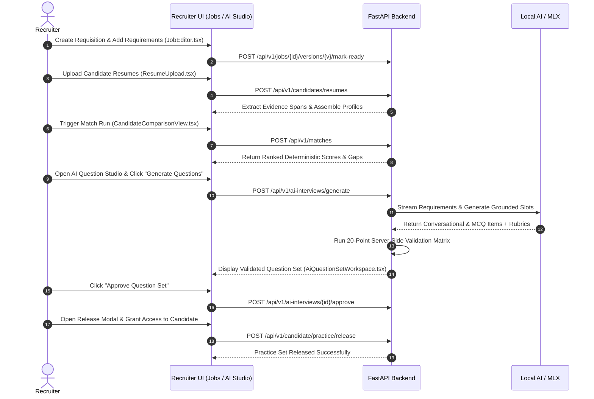
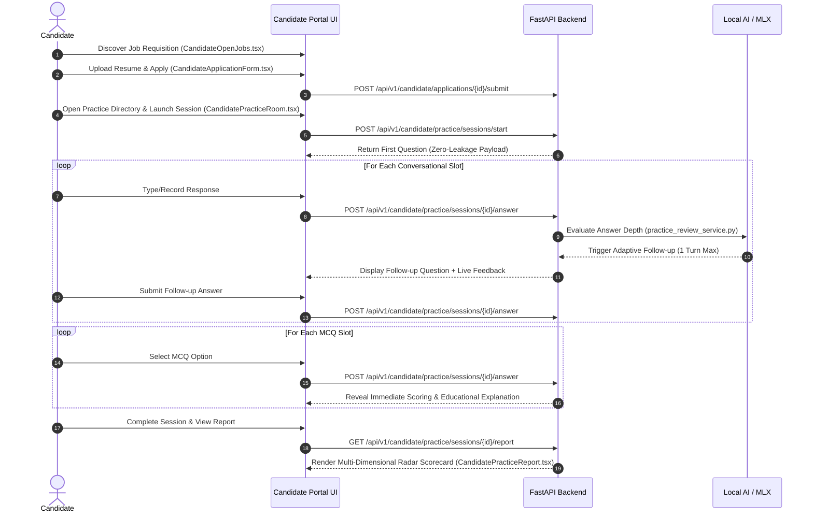
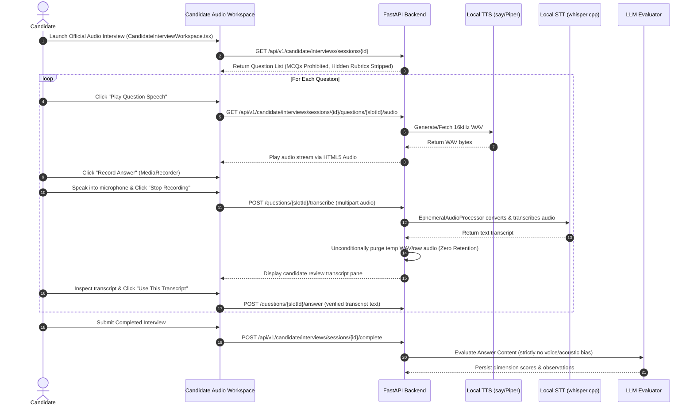

# AI-Hiring Platform: Frontend UI Components, Design System & User Journeys

**Document Version:** 2.2.0 (Comprehensive Reference)  
**Framework:** React 19 | TypeScript 5.5+ | Vite 6.0+ | Modern Vanilla CSS Glassmorphic Design System  
**Scope:** Complete Frontend Directory Inventory, 12 Strongly-Typed API Clients, 2 Auth Context Providers, 64 UI Components & Styling across 9 Specialized Subsystems, 42 Vitest Test Suites, Complete End-to-End User Journeys (including Dual-Mode Audio Interviews), and Comprehensive Inter-File Architecture

---

## 1. Frontend Architecture & Directory Catalog

The frontend is a modern Single-Page Application (SPA) built with React 19 and TypeScript, powered by Vite. It uses a bespoke **Vanilla CSS Design System** (`index.css`) that delivers a sleek dark-mode glassmorphic aesthetic without the overhead of external CSS utility frameworks.

```
frontend/
├── index.html                               # HTML5 entry document with viewport meta and fonts
├── package.json                             # Dependencies, scripts, and Vitest configuration
├── tsconfig.json                            # Strict TypeScript compiler options
├── vite.config.ts                           # Vite bundler configuration and dev proxy
└── src/
    ├── App.tsx                              # Root application component and tab-based router
    ├── main.tsx                             # Application bootstrapping and React DOM rendering
    ├── index.css                            # Master Vanilla CSS Design System (Glassmorphic dark-mode)
    ├── setupTests.ts                        # Vitest test setup, DOM extensions, cleanup hooks
    ├── api/                                 # 12 Strongly-Typed API Client Modules
    ├── components/                          # 64 Reusable UI and Domain View Components
    │   ├── admin/                           # 2 Administrator Workspace Components
    │   ├── ai_interviews/                   # 7 AI Interview Studio Components & CSS (Text vs. Audio mode)
    │   ├── ats/                             # 2 ATS Modal Dialogs
    │   ├── auth/                            # 2 Authentication Views
    │   ├── candidate/                       # 16 Candidate Portal Views & Components (Audio Recording & Playback)
    │   ├── common/                          # 8 Reusable UI Primitives
    │   ├── evaluation/                      # 2 Evaluation Workspace Components & CSS
    │   ├── interviews/                      # 5 Requisition Interview Builder & Simulation Views
    │   ├── jobs/                            # 10 Job Requisition & Applicant Workflow Components
    │   ├── reviewer/                        # 1 Reviewer Benchmark Workspace Component
    │   └── [root components]                # 9 Top-Level Layout & Profile Review Drawers
    ├── context/                             # 2 Auth & Session State Context Providers
    ├── types/                               # 3 TypeScript Domain Type Modules
    ├── utils/                               # 2 Client Routing and Portal DOM Utilities
    └── __tests__/                           # 42 Vitest & React Testing Library Test Suites
```

---

## 2. Core Infrastructure & Configuration Files

### 2.1 `src/App.tsx`
- **Purpose**: Root application component managing global tab-based navigation, role detection (`ADMIN`, `RECRUITER`, `CANDIDATE`), session hydration, and view mounting.
- **Key Capabilities**:
  - Tab Switcher: Reads and synchronizes URL search parameters (`?tab=jobs`, `?tab=candidates`, `?tab=ai_interviews`, `?tab=admin`, `?tab=evaluation`).
  - Dual Portal Partitioning: Seamlessly toggles between the Recruiter/Admin Portal (`AuthenticatedShell`) and the Candidate Portal (`CandidateShell`).
  - Context Provider Wrapping: Wraps tree with `AuthProvider` and `CandidateAuthProvider`.

### 2.2 `src/main.tsx` & `src/index.html`
- **Purpose**: Renders the React root into `<div id="root"></div>`.
- **Fonts**: Loads Google Fonts (*Inter* for high-legibility UI text and *Outfit* for modern display headers).

### 2.3 `src/index.css` (Master Vanilla CSS Design System)
- **Design Tokens**:
  - Backgrounds: Dark Obsidian Base (`#0B0F19`), Card Glass (`rgba(17, 24, 39, 0.75)` with `backdrop-filter: blur(16px)`).
  - Accents: Electric Indigo (`#6366F1`), Cyan Teal (`#06B6D4`), Emerald Green (`#10B981`), Amber Warning (`#F59E0B`), Crimson Danger (`#EF4444`).
  - Typography: Scaled typographic hierarchy from display headings (`h1` 2.25rem) to micro-labels (0.6875rem).
- **Glassmorphic Surface Classes**:
  - `.card-glass-subtle`: 1px translucent border (`rgba(255, 255, 255, 0.08)`), subtle shadow.
  - `.card-glass-elevated`: Hover elevation with glow shadow (`box-shadow: 0 12px 32px -4px rgba(99, 102, 241, 0.15)`).
  - `.btn-primary`, `.btn-secondary`, `.btn-danger`: Styled buttons with hover/active transitions.

### 2.4 `src/setupTests.ts`
- **Purpose**: Test runner initialization importing `@testing-library/jest-dom` matchers and configuring global DOM mocks (`window.matchMedia`, `ResizeObserver`, `scrollIntoView`).

---

## 3. Typed API Client Modules (`src/api/`)

The 12 API client modules wrap `fetch` to automatically inject CSRF tokens, serialize JSON, handle credentials, and raise structured API errors:

| API Client File | Target Backend Endpoints | Key Exported Functions |
|---|---|---|
| `client.ts` | Base HTTP Fetch Wrapper | `apiFetch<T>(endpoint, options)`: Injects `X-CSRF-Token` from cookie, sets `credentials: 'include'`, converts errors to `ApiError`. |
| `ats.ts` | `/api/v1/ats` | `fetchAtsConnections()`, `testAtsConnection(id)`, `syncAtsJobs(id)`, `importAtsCandidates(id)`, `exportCandidateToAts(candidateId, connId)`. |
| `candidateApplications.ts` | `/api/v1/candidate/applications` | `createDraftApplication(jobId)`, `uploadApplicationResume(appId, file)`, `fetchResumeStatus(appId)`, `submitApplication(appId)`, `fetchMyApplications()`, `fetchApplicationDetail(appId)`, `withdrawApplication(appId)`. |
| `candidateAuth.ts` | `/api/v1/candidate/auth` | `activateCandidate(token, password)`, `loginCandidate(email, password)`, `fetchCandidateMe()`, `logoutCandidate()`. |
| `candidateEvaluations.ts` | `/api/v1/candidate/evaluation` | `fetchCandidateEvaluations()`, `fetchEvaluationDetail(id)`, `submitEvaluationScore(id, payload)`. |
| `candidateInterviews.ts` | `/api/v1/ai-interviews` & `/api/v1/candidate/interviews` | `fetchAiQuestionSets()`, `generateAiQuestionSet(jobId, verId)`, `approveAiQuestionSet(id)`, `fetchCandidateInterviewSession(sessionId)`. |
| `candidateJobs.ts` | `/api/v1/candidate/jobs` | `fetchCandidateOpenJobs()`, `fetchCandidateJobDetail(jobId)`. |
| `candidatePractice.ts` | `/api/v1/candidate/practice` | `fetchCandidatePracticeCatalog()`, `requestPracticeRelease(jobId)`, `fetchRecruiterEligibleJobs(candidateId)`, `releasePracticeSet(candidateId, payload)`, `revokePracticeRelease(releaseId)`. |
| `candidatePracticeSession.ts` | `/api/v1/candidate/practice/sessions` | `startPracticeSession(releaseId)`, `fetchPracticeSession(sessionId)`, `submitPracticeAnswer(sessionId, payload)`, `fetchPracticeReport(sessionId)`. |
| `jobs.ts` | `/api/v1/jobs` & `/api/v1/matches` | `fetchJobs()`, `fetchJobDetail(id)`, `createJob(data)`, `createJobVersion(id, data)`, `saveRequirements(id, verId, reqs)`, `markJobReady(id, verId)`, `publishJob(id)`, `archiveJob(id)`. |
| `recruiterApplications.ts` | `/api/v1/recruiter/applications` | `fetchJobApplicants(jobId)`, `fetchJobApplicantDetail(jobId, appId)`, `updateApplicantReviewState(jobId, appId, state)`, `releaseApplicantInterview(jobId, appId, questionSetId)`. |
| `taxonomy.ts` | `/api/v1/taxonomy` | `searchSkills(query)`, `searchOccupations(query)`, `resolveConcept(conceptId)`. |

---

## 4. Context State Providers (`src/context/`)

### 4.1 `AuthContext.tsx` (Recruiter & Admin Auth)
- **State**: `user` (`User | null`), `organization` (`Organization | null`), `isAuthenticated` (`boolean`), `isLoading` (`boolean`), `csrfToken` (`string | null`).
- **Methods**:
  - `login(credentials)`: Authenticates recruiter/admin, sets session cookie, initializes CSRF token.
  - `logout()`: Clears active session and redirects to `/login`.
  - `refreshSession()`: Calls `GET /api/v1/auth/me` on initial app load.

### 4.2 `CandidateAuthContext.tsx` (Candidate Portal Auth)
- **State**: `candidate` (`CandidateIdentity | null`), `isAuthenticated` (`boolean`), `isLoading` (`boolean`).
- **Methods**:
  - `activateAccount(token, password)`: Consumes magic activation token and binds user account.
  - `login(email, password)`: Authenticates candidate against `/api/v1/candidate/auth/login`.
  - `logout()`: Terminates candidate session.

---

## 5. UI Components Catalog (`src/components/` - 62 Components)

### 5.1 Root Layout, Profile Inspection & Audit Drawers (7 Components)
- **`AuthenticatedShell.tsx`**: Top navigation header for recruiters/admins featuring platform logo, active workspace pill (`Recruiter workspace` / `Admin workspace`), navigation tabs (*Jobs*, *Candidates*, *Upload Resume*, *AI Interviews*, *ATS*, *Evaluation*), database connectivity indicator, and user profile dropdown.
- **`CandidatesDirectory.tsx`**: Master table of all candidates in the organization with search, status filters, and one-click access to profile reviews, evidence drawers, and practice releases.
- **`CandidateProfileReview.tsx`**: Structured candidate profile viewer showing extracted contact details, employment history, education, skills, and projects.
- **`EvidenceDrawer.tsx`**: Slide-out drawer displaying original resume text with highlighted bounding-box evidence spans corresponding to extracted skills and job titles.
- **`ExtractionReview.tsx`**: Audit interface comparing raw parsed text against structured entities.
- **`Icon.tsx`**: Lightweight SVG icon system supporting 50+ icons (`user`, `users`, `user-check`, `spinner`, `briefcase`, `sparkles`, `file-text`, `plus`, `edit`, `trash`, `shield-check`, etc.).
- **`ResumeUpload.tsx`**: Drag-and-drop file uploader supporting PDF and Word DOCX documents with upload progress indicators.
- **`ReviewDrawer.tsx`**: Recruiter manual profile correction drawer allowing granular edits (`REPLACE`, `DELETE`, `ADD`).
- **`VersionHistoryDrawer.tsx`**: Audit drawer showing point-in-time revision history of candidate profiles.

### 5.2 Job Requisitions & Applicant Review (`src/components/jobs/` - 10 Components)
- **`JobsDirectory.tsx`**: Searchable, filterable list of all job requisitions showing title, department, location, version number, lifecycle badge (`DRAFT`, `READY`, `PUBLISHED`), opening counts, and applicant counters.
- **`JobEditor.tsx`**: Comprehensive split-pane requisition editor allowing recruiters to edit metadata, author grounded requirements with taxonomy autocomplete, validate readiness rules, create new revisions, and publish/archive jobs.
- **`RequirementCard.tsx`**: Visual card representing an individual job requirement with necessity tag (`MUST_HAVE` / `PREFERRED`), category badge (`SKILL`, `EXPERIENCE`, `EDUCATION`), weight slider, and delete/edit controls.
- **`OccupationSelector.tsx`**: Modal and input component searching O*NET occupational taxonomy codes.
- **`TaxonomySkillAutocomplete.tsx`**: Typeahead search component querying canonical skill taxonomy and displaying concept pills.
- **`JobApplicantsView.tsx`**: Applicant table for a specific job requisition showing candidate name, submission date, application status (`SUBMITTED`, `WITHDRAWN`), review stage (`RECEIVED`, `IN_REVIEW`, `INTERVIEW_READY`), deterministic match score %, and interview release state.
- **`JobApplicationDetailView.tsx`**: Detailed applicant view displaying contact info, profile version, stage transition action buttons (*Start Review*, *Mark Interview Ready*, *Release Interview*), and candidate match breakdown.
- **`CandidateComparisonView.tsx`**: Side-by-side candidate comparison matrix comparing multiple candidates against job requirements with visual skill match indicators.
- **`RequirementGapReportView.tsx`**: Categorical gap report inspector showing missing mandatory vs. preferred skills.
- **`VisualAnalyticsCharts.tsx`**: Visual SVG charts displaying skill coverage distributions and candidate score bars.

### 5.3 AI Interview Studio (`src/components/ai_interviews/` - 7 Items)
- **`AiInterviewsDirectory.tsx`**: Table of all job requisitions displaying AI interview generation status, question count, and 20-point validation pass state.
- **`AiQuestionSetWorkspace.tsx`**: Main question studio workspace displaying conversational and MCQ question cards, validation status badges (`PASSED`, `FAILED`), wording assistance triggers, and the single-click *Approve Question Set* button.
- **`CandidateSafePreviewModal.tsx`**: Zero-leakage modal demonstrating exactly what the candidate will see in their practice sandbox (with all recruiter rubrics stripped).
- **`McqAuthoringModal.tsx`**: Modal for creating and editing Multiple-Choice Questions (options, correct answer key, educational explanation).
- **`ReleaseInterviewSetModal.tsx`**: Modal allowing recruiters to release approved AI interview sets to applicants.
- **`SafeRubricModal.tsx`**: Recruiter-only modal displaying internal evaluation rubrics, 1/3/5 rating anchors, and permitted follow-up probes.
- **`ai-interviews.css`**: Studio-specific CSS styling, grid layouts, and validation badge animations.

### 5.4 Candidate Portal Views (`src/components/candidate/` - 16 Components)
- **`CandidateShell.tsx`**: Candidate portal layout featuring branded header, candidate name, navigation tabs (*Open Jobs*, *My Applications*, *Practice Interviews*), and logout button.
- **`CandidateOpenJobs.tsx`**: Public job board displaying published requisitions with search, department filters, and *Apply* action buttons.
- **`CandidateJobDetail.tsx`**: Detailed candidate view of a published requisition with full description and requirements.
- **`CandidateApplicationForm.tsx`**: Resume-first application modal allowing candidates to upload a resume file (PDF/DOCX), monitor real-time extraction, and submit their application.
- **`CandidateMyApplications.tsx`**: Candidate dashboard showing active and withdrawn applications with submission timestamps and status badges.
- **`CandidateApplicationDetail.tsx`**: Detailed application view allowing candidates to inspect their submitted application and execute application withdrawal.
- **`CandidatePracticeDirectory.tsx`**: Candidate practice catalog displaying all practice sets released by recruiters or requested by the candidate.
- **`CandidatePracticeRoom.tsx`**: Interactive practice simulation sandbox supporting conversational voice/text answers, real-time AI feedback, 1-turn adaptive follow-up questions, and interactive MCQ choices.
- **`CandidatePracticeReport.tsx`**: Multi-dimensional radar coaching report displaying competency scores (0–100), key strengths, prioritized areas for improvement, and interview coaching playbooks.
- **`CandidateInterviewWorkspace.tsx`**: Formal candidate interview execution workspace for scheduled evaluations.
- **`CandidateFeedbackModal.tsx`**: Candidate post-session feedback modal.
- **`CandidateActivationPage.tsx`**: Account activation page where invited candidates enter their magic token and establish their password.
- **`CandidateLoginPage.tsx`**: Candidate portal login page.
- **`CandidateRegisterPage.tsx`**: Candidate self-registration page.
- **`CandidatePracticeReleaseModal.tsx`**: Recruiter modal to inspect release diagnostics against the 20 criteria and release a question set to a candidate.
- **`CandidateInvitationModal.tsx`**: Recruiter modal to issue single-use magic invitations to candidate emails.

### 5.5 Candidate Evaluation Workspace (`src/components/evaluation/` - 2 Items)
- **`EvaluationWorkspace.tsx`**: Comprehensive recruiter workspace for evaluating completed candidate interviews, displaying radar analytics, per-question scorecards, evidence snippets, and recruiter feedback notes.
- **`evaluation.css`**: Evaluation workspace specific layout and radar chart styling.

### 5.6 Admin & ATS Workspaces (`src/components/admin/` & `src/components/ats/` - 4 Components)
- **`AdminWorkspace.tsx`**: System admin console with tabs for User Management, Security Audit Events, AI Model Provider Adapters, and ATS Connections.
- **`AtsConnectionsAdmin.tsx`**: Configuration panel for external ATS connectors (Greenhouse, Lever, Local Folder ATS).
- **`AtsImportModal.tsx`**: Modal for importing requisitions and candidate resumes from connected ATS systems.
- **`AtsExportModal.tsx`**: Modal for exporting scored candidates and match rankings back to ATS.

### 5.7 Requisition Interview Builder & Simulation (`src/components/interviews/` - 5 Components)
- **`InterviewWorkspace.tsx`**: Deterministic interview template authoring workspace.
- **`InterviewReviewWorkspace.tsx`**: Human evaluation and calibration review workspace.
- **`SimulationWorkspace.tsx`**: Pre-release interview simulation tool for testing question sets against candidate profiles.
- **`AnchoredRubricModal.tsx`**: Modal displaying anchored 1/3/5 rating criteria.
- **`WordingComparisonModal.tsx`**: Side-by-side comparison modal for AI question wording variants.

### 5.8 Common UI Primitives (`src/components/common/` - 8 Components)
- **`Button.tsx`**: Accessible button with variants (`primary`, `secondary`, `danger`, `ghost`, `link`) and loading spinner states.
- **`Dialog.tsx`**: Accessible modal dialog with backdrop blur, focus trapping, and ESC key dismissal.
- **`FormField.tsx`**: Standardized form control container with label, helper text, and error validation messages.
- **`StatusBadge.tsx`**: Color-coded pill badge representing entity statuses (`DRAFT`, `READY`, `PUBLISHED`, `APPROVED`, etc.).
- **`InlineNotice.tsx`**: Alert banner with icons supporting `info`, `success`, `warning`, and `error` styles.
- **`PageHeader.tsx`**: Unified page title, breadcrumb, and action bar component.
- **`EmptyState.tsx`**: Standardized empty state card with vector icon, title, description, and primary action button.
- **`InterviewDimensionRadar.tsx`**: Reusable SVG radar chart component visualizing multi-dimensional competency scores.

### 5.9 Reviewer Workspace (`src/components/reviewer/` - 1 Component)
- **`ReviewerWorkspace.tsx`**: Internal reviewer workspace for benchmark evaluations against ground-truth datasets.

---

## 6. End-to-End User Journeys & Sequence Flows

### 6.1 Journey 1: Recruiter Sourcing, Matching & AI Practice Release


### 6.2 Journey 2: Candidate Application & Practice Simulation


### 6.3 Journey 3: Candidate Dual-Mode Audio Interview & Mode-Aware Evaluation


---

## 7. Vitest Component Testing Directory (`src/__tests__/` - 42 Test Files)

The frontend test suite contains 42 test files verifying all UI components, user interactions, and integration workflows:

```
frontend/src/__tests__/
├── auth_workflow.test.tsx                   # Tests login form, session validation, logout, and error alerts
├── candidate_comparison_gap_workflow.test.tsx # Tests candidate comparison matrix and skill gap inspector
├── candidate_portal_auth.test.tsx           # Tests magic token activation and candidate login views
├── candidate_practice_coaching.test.tsx     # Tests real-time per-answer feedback rendering in sandbox
├── candidate_practice_engine.test.tsx       # Tests practice turn-taking state machine and question advancement
├── candidate_practice_report.test.tsx       # Tests radar scorecard rendering and coaching recommendations
├── candidates_directory.test.tsx            # Tests candidate table sorting, filtering, and search inputs
├── color_policy.test.ts                     # Asserts CSS color tokens adhere to accessibility contrast rules
├── confidence_display.test.tsx              # Tests confidence badge indicators (HIGH, MEDIUM, LOW)
├── correction_workflow.test.tsx             # Tests manual profile correction drawer patch operations
├── dashboard_rendering.test.tsx             # Tests AuthenticatedShell header, workspace labels, and tabs
├── evidence_drawer.test.tsx                 # Tests resume evidence span highlighting and text offsets
├── extraction_review.test.tsx               # Tests raw text vs. structured entity extraction comparisons
├── interview_lifecycle_workflow.test.tsx    # Tests deterministic interview template lifecycle state changes
├── isolated_portals.test.tsx                # Tests strict separation between Recruiter and Candidate views
├── jobs_workspace.test.tsx                  # Tests job directory, JobEditor, versioning, and requirement builder
├── mcq_and_practice_release.test.tsx        # Tests MCQ authoring modal and candidate practice release modal
├── phase3d3_curated_and_review.test.tsx     # Tests curated question reviews and rubric anchor displays
├── phase3d4_final_reconstruction_and_evaluation.test.tsx # Tests evaluation harness result visualization
├── phase3d5_ai_workspace.test.tsx           # Tests AI Interview Workspace and candidate-safe previews
├── phase3e1_ui_foundation.test.tsx          # Tests core design system classes, typography, and buttons
├── phase3e3_jobs_and_ats.test.tsx           # Tests ATS export/import dialogs and connection configuration
├── phase3e3_local_folder_ats.test.tsx       # Tests Local Folder ATS sync triggers and file status badges
├── phase3g1_provenance_and_release.test.tsx # Tests 20-point validation badge display and release gating
├── phase4b3_candidate_job_discovery.test.tsx# Tests CandidateOpenJobs board and job detail rendering
├── phase4b4_candidate_applications.test.tsx # Tests resume application form, my applications, and withdrawal
├── phase4b5_recruiter_applicant_workflow.test.tsx # Tests JobApplicantsView and JobApplicationDetailView stages
├── phase4c1_interview_release.test.tsx      # Tests interview set release modals and candidate eligibility
├── phase4c2_candidate_interview_workspace.test.tsx # Tests candidate formal interview workspace
├── phase4c3_corrective_ui.test.tsx          # Tests corrective feedback and review drawer operations
├── phase4c4_evaluation_workspace.test.tsx   # Tests recruiter evaluation workspace and scoring
├── phase4d1_dual_mode_ui.test.tsx           # Tests AI Question Studio Text vs. Audio mode toggles and MCQ locks
├── phase4d2_dual_mode_release_ui.test.tsx   # Tests Release modal mode-specific channels and snapshot isolation
├── phase4d3_audio_execution_ui.test.tsx     # Tests candidate audio playback controls, mic recording & STT review
├── phase4d4_mode_aware_evaluation_ui.test.tsx # Tests Evaluation workspace mode badges, rubrics & scorecard rendering
├── provider_admin_and_interview_shell.test.tsx # Tests AI Model Provider configuration and test connections
├── recruiter_wording_assistance.test.tsx    # Tests AI wording assistant modal and rewrite suggestions
├── requirement_gap_report_view.test.tsx     # Tests RequirementGapReportView categorical skill tables
├── review_drawer.test.tsx                   # Tests profile correction drawer submission and error handling
├── simulation_and_template_repairs.test.tsx # Tests interview simulation workspace and template repair UI
├── version_history.test.tsx                 # Tests VersionHistoryDrawer point-in-time profile restoration
└── visual_analytics_navigation.test.tsx     # Tests visual analytics charts and score breakdown tab navigation
```

---

## 8. Comprehensive Inter-File Relationships & Architectural Coupling

The frontend components connect directly to typed API clients, state context providers, and backend REST endpoints:

```mermaid
graph TD
    subgraph UIComponentLayer ["UI Component Layer"]
        C_Shell["AuthenticatedShell.tsx / CandidateShell.tsx"]
        C_Jobs["jobs/JobEditor.tsx & JobsDirectory.tsx"]
        C_Cand["CandidatesDirectory.tsx & CandidateProfileReview.tsx"]
        C_AIStudio["ai_interviews/AiQuestionSetWorkspace.tsx"]
        C_Practice["candidate/CandidatePracticeRoom.tsx"]
        C_AudioWorkspace["candidate/CandidateInterviewWorkspace.tsx"]
        C_Eval["evaluation/EvaluationWorkspace.tsx"]
        C_Apps["candidate/CandidateMyApplications.tsx & jobs/JobApplicantsView.tsx"]
    end

    subgraph StateAndContext ["State & Context Providers"]
        Ctx_Auth["context/AuthContext.tsx"]
        Ctx_CandAuth["context/CandidateAuthContext.tsx"]
    end

    subgraph ApiClientLayer ["Typed API Client Layer (src/api/)"]
        A_Client["client.ts (Base Fetch + CSRF)"]
        A_Jobs["jobs.ts"]
        A_CandApps["candidateApplications.ts & recruiterApplications.ts"]
        A_CandInterviews["candidateInterviews.ts"]
        A_Practice["candidatePractice.ts & candidatePracticeSession.ts"]
        A_Eval["candidateEvaluations.ts"]
        A_Tax["taxonomy.ts"]
        A_Ats["ats.ts"]
    end

    subgraph BackendEndpoints ["Backend REST Endpoints"]
        BE_Jobs["/api/v1/jobs"]
        BE_Resumes["/api/v1/resumes"]
        BE_Matches["/api/v1/matches"]
        BE_AI["/api/v1/ai-interviews"]
        BE_Practice["/api/v1/candidate/practice"]
        BE_Audio["/api/v1/candidate/interviews"]
        BE_Eval["/api/v1/candidate/evaluation"]
    end

    C_Shell --> Ctx_Auth & Ctx_CandAuth
    C_Jobs --> A_Jobs & A_Tax
    C_Cand --> A_Client
    C_AIStudio --> A_CandInterviews
    C_Practice --> A_Practice
    C_AudioWorkspace --> A_CandInterviews
    C_Eval --> A_Eval
    C_Apps --> A_CandApps

    A_Jobs & A_CandApps & A_CandInterviews & A_Practice & A_Eval & A_Tax & A_Ats --> A_Client
    A_Jobs --> BE_Jobs
    A_Client --> BE_Resumes & BE_Matches
    A_CandInterviews --> BE_AI & BE_Audio
    A_Practice --> BE_Practice
    A_Eval --> BE_Eval
```



### Detailed Component-to-API Interaction Summary:
1. **Requisition Authoring & Taxonomy Search**: `components/jobs/JobEditor.tsx` calls `api/jobs.ts` and `api/taxonomy.ts` to fetch concept IDs and persist grounded requirements.
2. **Resumé Upload & Evidence Inspection**: `components/ResumeUpload.tsx` dispatches uploads via `api/client.ts` to `/api/v1/resumes`, while `components/EvidenceDrawer.tsx` queries bounding-box character offsets from candidate profiles.
3. **AI Interview Studio Authoring**: `components/ai_interviews/AiQuestionSetWorkspace.tsx` interacts with `api/candidateInterviews.ts` to trigger LLM question generation, toggle Text vs. Audio modes, inspect 20-point validation badges, and approve question sets.
4. **Candidate Practice Sandbox & Adaptive Probes**: `components/candidate/CandidatePracticeRoom.tsx` communicates with `api/candidatePracticeSession.ts` to step through turns, submit responses, receive immediate per-answer feedback, and transition to `components/candidate/CandidatePracticeReport.tsx` upon session completion.
5. **Dual-Mode Candidate Audio Execution**: `components/candidate/CandidateInterviewWorkspace.tsx` coordinates playback of question audio and captures browser microphone input via `MediaRecorder`. It sends audio to the transcribe endpoint and displays candidate-verified transcripts for explicit confirmation before submitting.
6. **Interview Evaluation & Radar Scorecards**: `components/evaluation/EvaluationWorkspace.tsx` queries `api/candidateEvaluations.ts` to render `components/common/InterviewDimensionRadar.tsx`, review answer transcripts (strictly grounded in transcript text), and assign final competency ratings.
