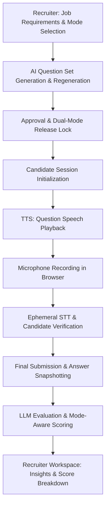
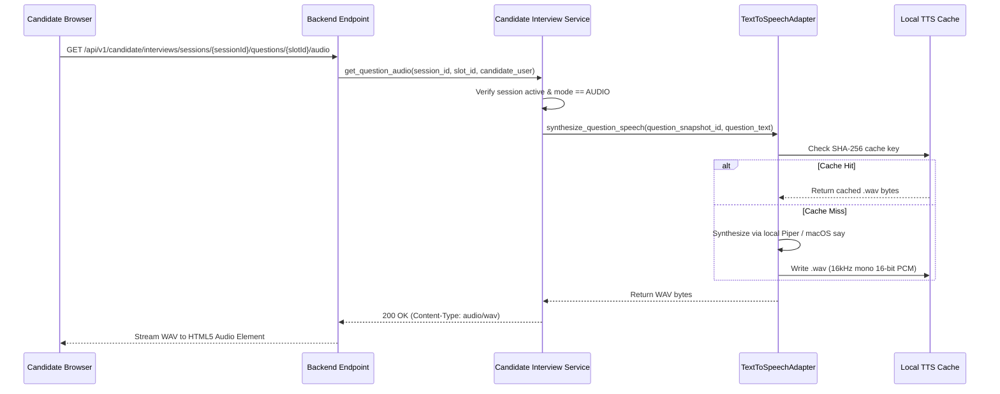
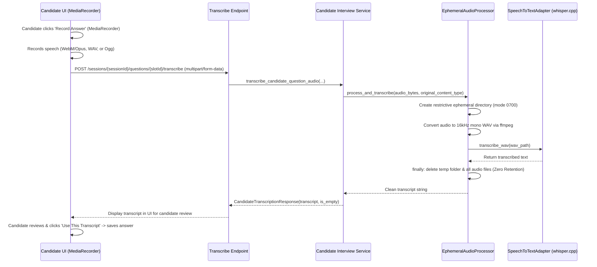

# Voice-Based AI Interview System: End-to-End Implementation Architecture

## 1. Executive Summary & Core Principles

The Voice-Based (Audio) Interview System extends the AI-Hiring platform with a **local-first, privacy-preserving, conversational interview experience**. The system supports **dual-mode interviews (TEXT vs. AUDIO)**, ensuring that each modality adheres to distinct workflows, audio lifecycle guarantees, zero cloud speech leakage, and tailored evaluation rubrics.

---

## 2. Architecture & Data Flow Overview

| Stage | Modality / Component | Key Backend Services | Key Frontend Components | Security & Privacy Guarantees |
| :--- | :--- | :--- | :--- | :--- |
| **1. Question Generation** | Audio-compatible AI Question Sets | `ai_interview_service.py`, `llm_client.py` | `AiQuestionSetWorkspace.tsx`, `JobPostingDetails.tsx` | Strictly excludes MCQs in Audio mode; enforces 100% conversational formats. |
| **2. Release & Isolation** | Mode-Specific Release & Frozen Snapshot | `interview_release_service.py` | `AiQuestionSetWorkspace.tsx` | Separate release channels for TEXT and AUDIO; snapshots freeze rubrics and text. |
| **3. Text-to-Speech (TTS)** | Question Audio Playback | `speech_service.py` (`TextToSpeechAdapter`), `candidate_practice.py` | `CandidateInterviewWorkspace.tsx` | Question text only (no rubrics/scoring criteria exposed); cached by SHA-256 hash. |
| **4. Speech-to-Text (STT)** | Ephemeral Audio Transcription | `speech_service.py` (`EphemeralAudioProcessor`, `SpeechToTextAdapter`) | `CandidateInterviewWorkspace.tsx` (`MediaRecorder`, audio preview) | **Zero-retention**: Raw candidate voice is deleted immediately in a `finally` block after transcription. |
| **5. LLM Evaluation** | Mode-Aware Scoring & Analysis | `ai_evaluation_service.py`, `candidate_interview_service.py` | `AiEvaluationWorkspace.tsx` | Audio rubrics emphasize verbal clarity, problem-solving, and communication over exact MCQ precision. |

---

## 3. Deep Dive: Stage-by-Stage Implementation

### Stage 1: AI Question Generation & Mode Specialization

1. **Mode-Specific Prompts & Constraints**:
   - When `interview_mode == "AUDIO"`, LLM generation prompts explicitly disallow multiple-choice questions (MCQs), markdown tables, and multi-part code snippet quizzes.
   - All questions are generated in conversational, behavioral, or open-ended scenario formats (e.g., *"Can you describe a time when you optimized a React component's render cycle?"*).
2. **Structural Validation & Invariant Enforcement**:
   - `ai_interview_service.py` enforces backend validation: Any manual or AI attempt to insert an MCQ slot into an Audio question set is rejected with an `HTTP 422 Unprocessable Content` (`AUDIO_MCQ_NOT_ALLOWED`).
   - Revision tracking ensures that if job requirements are modified post-generation, the workspace alerts the recruiter before release.

---

### Stage 2: Mode-Specific Release & Candidate Session Isolation

1. **Dual-Mode Release Channels**:
   - A single job requisition can maintain independent active releases for `TEXT` and `AUDIO` modes.
   - Releasing an Audio question set locks the configuration, sets `is_released=True`, and creates an immutable snapshot of question titles, texts, and hidden evaluation rubrics.
2. **Session Freezing & Rubric Hiding**:
   - When a candidate starts an interview (`POST /api/v1/candidate/interviews/{release_id}/start`), a `CandidateInterviewSessionRecord` is instantiated.
   - All question text is snapshotted to `questions_snapshot`. Evaluation rubrics, model answers, and scoring criteria are strictly stripped from all candidate-facing responses.

---

### Stage 3: Question Speech Synthesis (Text-to-Speech / TTS)

#### Key Technical Details:
- **Zero Cloud Leakage**: Synthesis runs 100% on the local host using local Piper TTS binaries or native macOS `say` subprocesses with `--data-format=LEI16@16000`.
- **Deterministic Caching**: Audio is keyed by `SHA-256(model:version:question_id:text_hash)` to prevent redundant re-synthesis and eliminate latency on repeated plays.
- **Frontend Playback Control**:
  - `CandidateInterviewWorkspace.tsx` manages single-instance `HTML5 Audio` playback with play, pause, and replay functionality.
  - Abort errors (`AbortError`) caused by rapid interaction or switching questions are gracefully handled without alerting false errors to the candidate.

---

### Stage 4: Candidate Audio Recording & Ephemeral STT

#### Key Technical Details:
- **Browser Media Capture**:
  - Checks secure context (`navigator.mediaDevices.getUserMedia`) before initializing.
  - Automatically selects supported browser audio MIME types (`audio/webm;codecs=opus`, `audio/webm`, `audio/ogg`, or `audio/wav`).
  - Halts active TTS playback immediately when recording starts to prevent microphone feedback leakage.
- **Strict Ephemeral Audio Isolation**:
  - Temp directory created with restrictive Unix file permissions (`0o700` directory, `0o600` files).
  - Subprocess calls use explicit argument vectors with `shell=False` to prevent command injection.
  - **Guaranteed Cleanup**: An unconditional `finally` block deletes all raw audio and intermediate WAV files immediately after transcription. No audio is ever stored in the database.
- **Candidate Verification & Consent**:
  - Candidates inspect the generated transcript in a read-only review pane.
  - Candidates can re-record if needed or click **"Use This Transcript"** to submit it as their official answer.

---

### Stage 5: Mode-Aware LLM Evaluation & Scoring (Transcript Content Only)

1. **Strict Content-Only Evaluation Policy**:
   - Audio interviews evaluate **accepted transcript text content only**.
   - **Prohibited Evaluation Criteria**: The LLM evaluator strictly **does not score or evaluate**:
     - Confidence inferred from voice
     - Pronunciation or accent
     - Pitch, speaking speed, or hesitation
     - Vocal tone, emotion, or acoustic professionalism
   - **Evaluated Dimensions (Grounding in Transcript Content)**:
     - **Technical Correctness & Accuracy**: Accuracy of concepts and technical decisions stated in the transcript.
     - **Relevance**: Direct alignment with the question asked and problem constraints.
     - **Reasoning & Problem-Solving Structure**: Logical progression, trade-off analysis, and methodical approach.
     - **Evidence & Concrete Examples**: Specific projects, technologies, and outcomes cited.

2. **Scoring Breakdown & Recruiter Insights**:
   - Evidence-grounded observations cite specific numbered answer segments (`S1`, `S2`).
   - Structured ratings and observations are surfaced in `AiEvaluationWorkspace.tsx` with clear indicators showing that assessments derive exclusively from candidate-verified transcripts.

---

## 4. Verification & Testing Matrix

| Test Suite | Purpose / Covered Invariants | Status |
| :--- | :--- | :---: |
| [`test_phase4d1_dual_mode_interviews.py`](file:///Users/herilvyas/Desktop/AI-Hiring/backend/tests/test_phase4d1_dual_mode_interviews.py) | Audio vs. Text question set schema validation, MCQ rejection in Audio sets | **Passed** |
| [`test_phase4d2_dual_mode_release.py`](file:///Users/herilvyas/Desktop/AI-Hiring/backend/tests/test_phase4d2_dual_mode_release.py) | Mode-specific release isolation, frozen question snapshots, rubric stripping | **Passed** |
| [`test_phase4d3_audio_execution.py`](file:///Users/herilvyas/Desktop/AI-Hiring/backend/tests/test_phase4d3_audio_execution.py) | TTS playback endpoints, STT ephemeral transcription, zero-retention temp file cleanup | **Passed** |
| [`test_phase4d4_mode_aware_evaluation.py`](file:///Users/herilvyas/Desktop/AI-Hiring/backend/tests/test_phase4d4_mode_aware_evaluation.py) | Mode-aware evaluation scoring, rubric application, candidate session transitions | **Passed** |
| [`phase4d3_audio_execution_ui.test.tsx`](file:///Users/herilvyas/Desktop/AI-Hiring/frontend/src/__tests__/phase4d3_audio_execution_ui.test.tsx) | Candidate audio workspace rendering, audio playback triggers, transcript persistence | **Passed** |
| [`phase4d4_mode_aware_evaluation_ui.test.tsx`](file:///Users/herilvyas/Desktop/AI-Hiring/frontend/src/__tests__/phase4d4_mode_aware_evaluation_ui.test.tsx) | Evaluation workspace UI rendering, score breakdown cards, modality badges | **Passed** |
